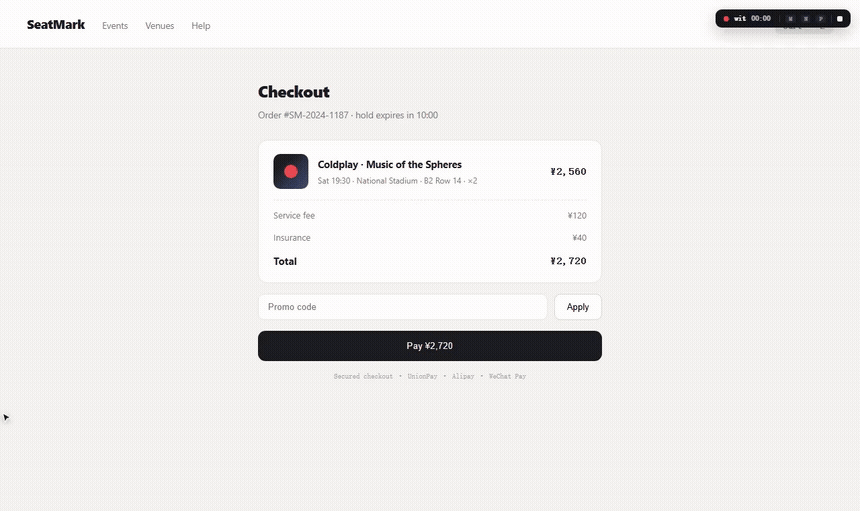

# Witness

**Voice-anchored causal evidence recorder for AI coding agents.**

[中文](README.zh-CN.md) · [witness.zalize.com](https://witness.zalize.com) · [VISION.md](VISION.md) · MIT

You experience the product and talk — *“this button does nothing.”*
Witness welds every word to the causal evidence of that exact second: clicks, requests,
console errors, DOM mutations, screenshots, full rrweb replay — then hands a structured
evidence package to your AI coding agent.



## Why

AI agents can't see what you see. Describing a visual bug costs ten minutes of
screenshots and prompt crafting — and still loses the *why*. Voice is the cheapest
annotation channel there is; it just never had a recorder.

Three streams run in parallel the moment `wit start` opens a managed browser:

1. **Your voice** — continuous audio + live transcription. One take, many issues.
2. **Operations + causal bursts** — every click captures its ~1.8s aftermath
   (requests, responses, console errors, DOM changes). A click with *no* aftermath
   is itself recorded as evidence.
3. **Page evolution** — rrweb full-DOM replay + event-driven screenshots + periodic
   DOM snapshots.

## Install

```bash
npm i -g github:wookat/witness        # needs Node 18+ and system Edge/Chrome
wit start http://localhost:5173       # managed browser opens — talk & click
```

No downloads, no API keys. System Edge/Chrome is preferred; bundled Chromium is the fallback.

## During recording

| Gesture | Effect |
|---|---|
| Browse + talk | Full audio; clicks/scrolls/inputs/navigation auto-logged; live transcript preview under the toolbar |
| `Ctrl+click` | Mark an element — selector, outerHTML, component chain, red-frame screenshot |
| `M` | Inspect mode: hover-highlight, click to mark; **drag to crop a region** |
| `N` | Explicit boundary marker — `⏺ ISSUE #n` divider; a strong grouping hint for the agent |
| `P` | Pause/resume — **all events and audio freeze** (privacy) |
| `■` / `Ctrl+C` | Stop and finalize the evidence package |

`events.jsonl` streams to disk as you go — kill the process and you lose only the last
few hundred milliseconds. `wit recover` rebuilds everything.

## CLI

```bash
wit start <url> [--lang en-US] [--duration 60] [--no-rr] [--associate]
                [--shot-format jpeg|webp] [--dsf 1|2] [--keyframes]
wit list                          # sessions with url/duration/say count
wit open latest                   # open review.html
wit transcribe <dir>              # re-run cloud ASR
wit correct <dir>                 # re-run LLM text polish
wit associate <dir>               # LLM picks relevant evidence per SAY (ZHIPU_API_KEY)
wit recover <dir>                 # rebuild artifacts after a crash
wit segments <dir>                # regenerate speech-anchor index + bundles
wit keyframes <dir>               # render rrweb → per-segment keyframe jpgs
wit mcp [dir]                     # stdio MCP server over the evidence
wit config asr <engine>           # live ASR: auto|doubao-web|doubao-ime|sr|off
```

## The evidence package — `.witness/sessions/<ts>_<host>/`

```
SEGMENTS.md       # speech anchors: verbatim + suspects + shot/dom refs (agents read first)
segments/*.md   # per-segment bundle: verbatim frags, dead clicks, errors, linked shots
keyframes/*.jpg  # rrweb-rendered replay frames per segment (wit keyframes)
KEYFRAMES.md     # keyframe index
segments.json    # machine-readable segment index (what MCP serves)
session.md      # timeline archive: each SAY block carries its causal burst
PROMPT.md       # paste-ready handoff instructions + page vocabulary
review.html     # human view: speech cards + audio seek + filmstrip + embedded rrweb replay
events.jsonl    # complete raw stream, crash-safe
rrweb.jsonl     # full DOM event stream (--no-rr to disable)
dom/*.html      # DOM snapshots on nav/mark/30s
assoc.json      # optional LLM evidence-association suggestions
shots/*.jpg     # click/mark crops + periodic + spoken-segment frames (--shot-format webp for ~35% smaller)
bodies/*.json   # response bodies ≤64KB
audio.webm / transcript.json
```

## MCP — evidence as an API

`wit mcp` serves the session over stdio. Point any MCP-capable agent
(Claude Code, Cursor, Devin) at it and it pulls exactly what it needs:

`list_segments` · `segment_detail(n)` · `session_overview` · `list_says` · `session_md` · `events_around(t_ms, radius, kinds)` ·
`get_errors` · `get_shot` · `get_body` · `get_dom_state(t)` · `get_asr` · `set_asr`

## Principles

- **Evidence is never rewritten** — speech lands verbatim; merging/correction/association are display-layer suggestions.
- **Evidence ≠ intent** — behavior without a spoken anchor is never presented as a bug.
- **Local-first** — deterministic recording; live SAY subtitles stream through free cloud ASR
  (`auto` = doubao-web → doubao-ime → browser SR fallback — pick via `wit config asr`, `--asr`, `WIT_ASR`, or the
  `get_asr`/`set_asr` MCP tools); final transcript falls back to bcut (bilibili editor ASR, no key needed)
  when no OPENAI key is set. LLM layers are optional.
- **Privacy engineered in** — password fields masked across four channels, credential fields redacted in POST bodies,
  `WIT_NO_BODIES=1` disables body capture, `P` freezes everything, `.witness/` is auto-gitignored.

## Development

```bash
npm install && npm run build && npm link
npm test        # build + node:test suite (align / speech-run / bursts / prompts / review html)
```

MIT.
