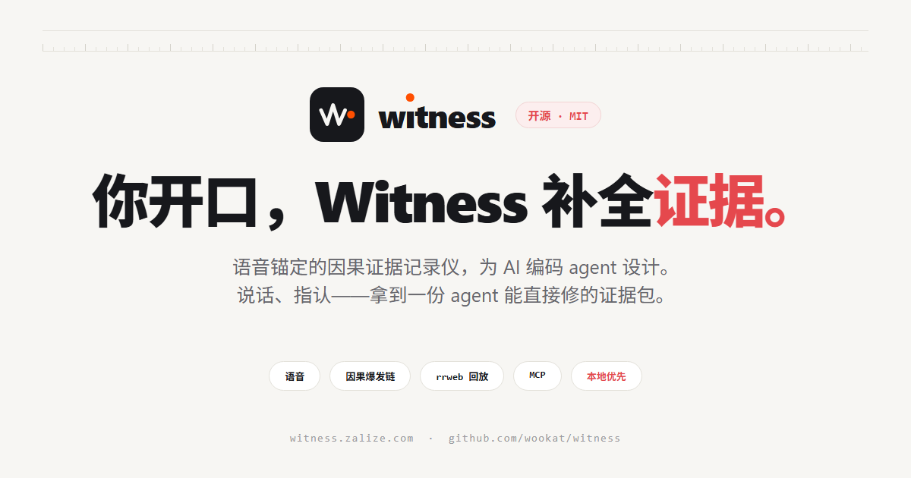
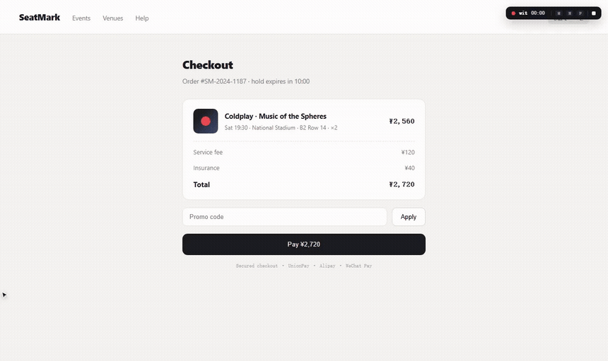
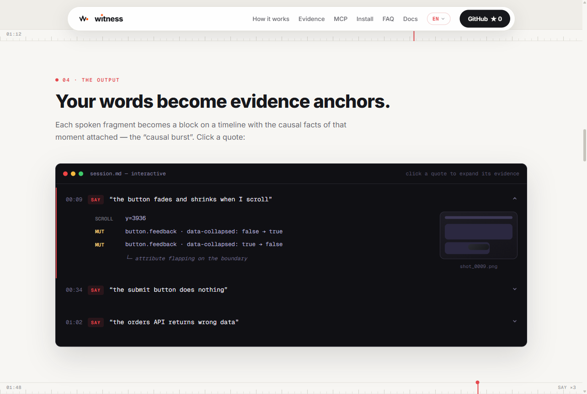

<div align="center">
  <a href="https://witness.zalize.com"></a>
  <br><br>
  <a href="https://github.com/wookat/witness/stargazers"></a>
  <a href="LICENSE"></a>
  
  
  <br>
  <a href="README.md">English</a> · <b>中文</b> · <a href="https://witness.zalize.com">witness.zalize.com</a> · <a href="VISION.md">愿景与路线 VISION.md</a>
</div>

<br>

**语音锚定的因果证据记录仪——为 AI 编码 agent 设计。**

你像平时一样体验产品、用嘴说哪里不对——“这个按钮点了没反应”。
Witness 把你说的每句话焊死在那一秒发生的因果事实上：点击、请求、报错、DOM 变化、截图、rrweb 全量回放——产出一份结构化证据包，直接喂给 AI agent 修。

<p align="center"></p>

## 为什么

AI agent 看不到你眼睛看到的：视觉 bug、jank、“点了没反应”。用人话写清楚要十分钟截图标注——信息还是会丢。说话是最便宜的标注通道，只是从来没有人给它做记录仪。

`wit start` 打开托管浏览器后，三条记录线并行：

1. **你的话**——全程录音 + 实时转写。一段话可以报多个问题，不打断不切分。
2. **操作 + 因果爆发链**——每次点击捕获随后 ~1.8s 的全部后果（请求/响应/console 报错/DOM 变化）。点击后什么都没发生，本身就记为证据。
3. **页面演变**——rrweb 全量 DOM 回放 + 事件驱动截图 + 周期 DOM 快照。

## 安装

```bash
npm i -g github:wookat/witness        # 需要 Node 18+ 和系统 Edge/Chrome
wit start http://localhost:5173       # 托管浏览器打开——正常体验+说话
```

`rec` 是 `wit` 的别名——同一个二进制，少敲三个字母。

零下载、零 key。优先系统 Edge/Chrome，没有再装自带 chromium。

## 录制中

| 手势 | 动作 |
|---|---|
| 正常浏览+说话 | 全程录音；点击/滚动/输入/导航自动记录；识别文字实时显示在工具栏下方 |
| `Ctrl+点击` | 标记元素（selector+outerHTML+组件链+红框截图） |
| `M` | Inspect：悬停高亮，点选标记；**拖拽圈选区域**截局部图 |
| `N` | 显式边界标记——`⏺ ISSUE #n` 分隔，是给 agent 归组的强提示 |
| `P` | 暂停/继续——暂停期**所有事件与录音都冻结**（隐私） |
| `Esc` | 退出 inspect 模式 |
| `■` / `Alt+Shift+R` | 停止并生成证据包 |

events.jsonl 边录边落盘——进程被杀也只丢最后几百毫秒，`wit recover` 随时重建全部产物。

## agent 读到什么

每个语音片段落进时间轴成为 `SAY` 块，带着那一秒的因果爆发链——死点击、DOM 变化、报错——挂好截图和 DOM 快照。

<p align="center"></p>

## 命令

```bash
wit start <url> [--lang en-US] [--duration 60] [--no-rr] [--associate]
                [--shot-format jpeg|webp] [--dsf 1|2] [--keyframes]
wit list                          # sessions 列表（url/时长/say 数）
wit open latest                   # 打开 review.html
wit transcribe <dir>              # 重跑云端转写
wit correct <dir>                 # 重跑 LLM 纠错
wit associate <dir>               # LLM 给每段语音挑相关证据（需 ZHIPU_API_KEY）
wit recover <dir>                 # 崩溃后从 events.jsonl 重建产物
wit segments <dir>                # 重建语音段索引 + 每段证据包
wit keyframes <dir>               # rrweb → 每段关键帧 jpg（agent 可读的回放）
wit mcp [dir]                     # stdio MCP server
wit config asr <engine>           # 实时 ASR：auto|doubao-web|doubao-ime|sr|off
```

## 证据包 `.witness/sessions/<ts>_<host>/`

面向 agent 的产物（PROMPT.md / SEGMENTS.md / session.md）一律以英文生成——LLM 最稳的语料；你的原话永远逐字保留，不翻译。

```
SEGMENTS.md       # 语音段索引：原话+嫌疑元素+截图/DOM 引用（agent 先读；段≠问题，归组归 agent）
segments/*.md     # 每段一包：逐段原话 + 死点击 + 报错 + 挂图
keyframes/*.jpg   # rrweb 回放渲染的关键帧（wit keyframes / --keyframes）
KEYFRAMES.md      # 关键帧索引
segments.json     # 机器可读的语音段索引（MCP 对外服务的就是它）
session.md      # 时间轴档案：每段 SAY 下挂因果爆发链
PROMPT.md       # 可粘贴给 agent 的交接模板 + 页面词表
review.html     # 回放页：语音卡片 + 音频跳转 + 胶片条 + 内嵌 rrweb 回放
events.jsonl    # 全量原始事件，崩溃安全
rrweb.jsonl     # rrweb DOM 事件流（--no-rr 关闭）
dom/*.html      # DOM 快照（nav/mark/每30s）
assoc.json      # （可选）LLM 证据关联建议
shots/*.jpg     # click/mark 裁切 + 周期 + 说话段截图（--shot-format webp 省 ~35% 体积）
bodies/*        # 响应体 ≤64KB（JSON 存 .json，其余 .txt）
session.json    # 元数据：url/时长/ASR 引擎/计数
audio.webm / transcript.json
```

## MCP——agent 主动挖证据

`wit mcp` 把 session 变成 stdio MCP server。配进任何 MCP agent（Claude Code/Cursor/Devin），
它按需查询而不是吞全文：

`list_segments` · `segment_detail(n)` · `session_overview` · `list_says` · `session_md` · `events_around(t_ms, radius, kinds)` ·
`get_errors` · `get_shot` · `get_body` · `get_dom_state(t)` · `get_asr` · `set_asr`

## 原则

- **证据不改写**——原话原样落盘；合并/纠错/关联只是展示层建议。
- **证据 ≠ 意图**——没有语音锚点的行为不会被当成 bug 汇报。
- **本地优先**——默认确定性记录；实时字幕走免费云端流式 ASR（`auto` = doubao-web → doubao-ime → 浏览器 SR 兜底，`wit config asr` / `--asr` / `WIT_ASR` / MCP `set_asr` 可切）；LLM 全是可选层。
- **隐私内置**——密码四通道打码；POST 体凭证字段脱敏；`WIT_NO_BODIES=1` 关响应体；`P` 全冻结；`.witness/` 自动 gitignore。

## 开发

```bash
npm install && npm run build && npm link
npm test        # 编译 + node:test（align / speech-run / burst / prompt / review html）
```

<br>

<div align="center">
  
  <br>
  <sub>Built by <b>zalize</b> (<a href="https://github.com/wookat">@wookat</a>) · <a href="LICENSE">MIT</a></sub>
</div>
